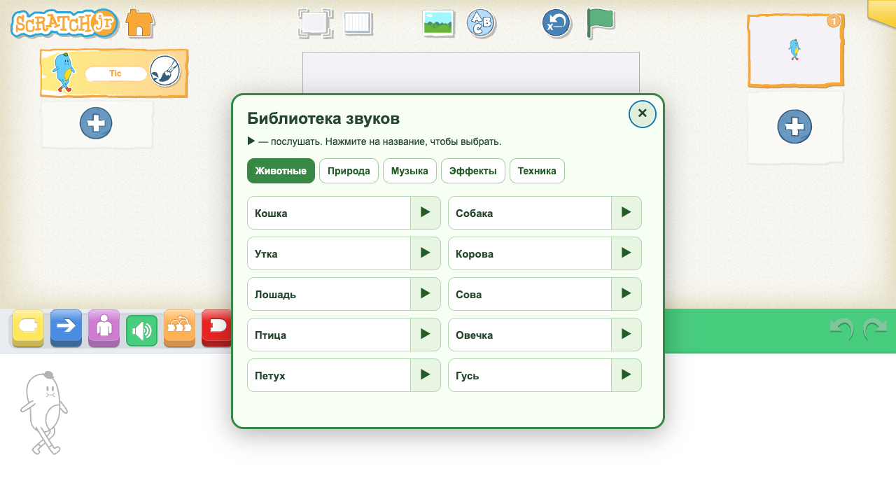

> Исторический отчёт о предварительной Classroom-сборке до переименования. Названия, снимки и результаты относятся к указанной версии. [Текущий выпуск J-GET Junior](JGET-RELEASE.md).

# ScratchJr Classroom 1.3.2-classroom.4 — библиотека звуков

15 ноября 2026 года.

Добавлены 43 готовых звука, включая 15 животных и 9 звуков природы. Вместе с прежним pop в каталоге 44 звука. Звуки находятся в приложении и работают без сети. Каталог содержит также музыку, игровые эффекты и технику. Условия и источники аудио — в [SOUND-ASSETS.md](SOUND-ASSETS.md) и распространяемом `src/app/sounds/library/ATTRIBUTION.txt`.

В зелёной категории нажмите название со стрелкой в звуковом блоке. В библиотеке кнопка ▶ проигрывает пример, название выбирает звук. Выбранный блок можно перетащить в программу; название в уже добавленном блоке тоже открывает библиотеку. Первым открывается раздел животных. Закрытие библиотеки, Escape и переход в другой раздел останавливают пример.

В проект сохраняется постоянный идентификатор файла. Записи с микрофона и их индексы остаются прежними; добавление встроенных звуков не занимает места в списке записей персонажа. Выбор в программе поддерживает отмену. При копировании цепочки между персонажами сохраняется выбранный встроенный звук.

Для передачи проекта с новыми звуками на другой компьютер нужна версия Classroom .4 или новее: стандартный экспорт ScratchJr не вкладывает встроенные звуки в архив проекта. В старой версии новые звуки недоступны.

## Проверки

- `node --experimental-vm-modules test/sound-library.js`: все 44 аудиофайла, распознавание каталога, предварительная загрузка, идентификаторы при сохранении/восстановлении и копировании, вложенный повтор, продолжение цепочки после звука, выбор и отмена, индексы записей, остановка примера при закрытии.
- `node test/sound-client.js`: начало с нуля, остановка с перемоткой, завершение при ошибке, отсутствие файла, старый API play без Promise, защита нового воспроизведения от запоздалой ошибки предыдущего.
- Существующие проверки keyboard-ui, keyboard-runtime, target-collision-ui, target-collision-runtime, editor-close и paint-regression прошли. `git diff --check` прошёл.
- В настоящем Chromium на macOS мышью открыта библиотека, проигран пример кошки с событиями playing и ended, выбран звук и перетянут блок в программу. Сохранение в отдельную тестовую базу и перезагрузка страницы восстановили `playsnd(library/cat.wav)` с прежними координатами. Прикладных ошибок в браузере не было; отсутствующий тестовый favicon не относится к приложению.

- В Mac Intel-сборке проверены все 474 исходных текстовых ресурса и побайтное включение 43 WAV с атрибуцией. Для изменённых модулей сверены хеши, результат Babel и загрузка производственным electron-compile. Предпрослушивание получает data URI через тот же мост, что и звуковые блоки; прямое чтение WAV старым file-протоколом не используется.

## Границы проверки

Новая библиотека и воспроизведение проверяются на одном Mac. Установка и запуск на физическом Windows-ноутбуке и работа в школьном классе отдельно не подтверждены. Windows-установщик не имеет цифровой подписи.

## Нативное воспроизведение на Mac

На этом Mac запущена отдельная копия финального Intel-приложения через Rosetta: Electron 1.8.2-beta.3, Chromium 59, x64. Для теста назначены отдельные папки Documents/Profile. Все 43 файла загрузили метаданные через iOS.getSoundSource и декодировались WebAudio. Кошка (0,847528 с) и дождь (6 с) прошли playing → ended через ScratchAudio с done=true. Независимые объекты предпрослушивания также воспроизвелись полностью; объекты исполнения блоков остались приостановленными и с прежней позицией. Полный сценарий выбора проверен в Chromium, как описано выше; нативная проверка охватывала загрузку и воспроизведение аудио.

Нативные отчёты текущего сеанса: `/private/tmp/sjr-sound-native/result.json`, `/private/tmp/sjr-sound-native/runtime.json`.

Установленная `/Applications/ScratchJr.app` обновлена до .4; все 9057 обычных файлов совпали с проверенной сборкой. Предыдущая версия сохранена в `Mac/Backups/2026-11-15/ScratchJr-classroom.3-before-sounds.app`. Контрольная сумма пользовательской базы до и после обновления совпала.

## Готовые файлы

- Windows: `../../Windows/ScratchJr-Classroom-Setup.exe`, 97 891 760 байт, SHA-256 `45bbbf7a79363321fd71246a8ce9f046bd996f251accaa35d1273e40f091ef6e`. Все 9006 файлов распакованного установщика совпали с проверенной сборкой. Прежний установщик .3 сохранён с номером версии в имени.
- Mac Intel: `../../Mac/ScratchJr-Classroom-1.3.2-classroom.4-mac-Intel.zip`, SHA-256 `26d1952206db6054b1b414575e4998594c2c2d1d51933bc02c3edb964385d778`.
- [Проверка пакетов](sound-library-checks/PACKAGES.md), [нативного аудио](sound-library-checks/native-audio.json), [установки Mac](sound-library-checks/mac-install.json).
